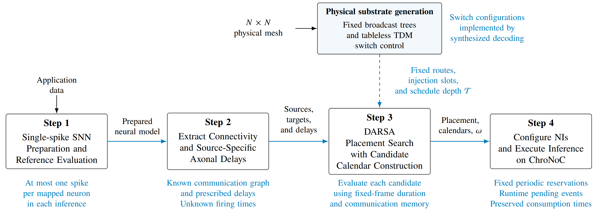

# ChroNoC

Companion implementation for **ChroNoC**, a tableless TDM network-on-chip,
and **Deadline-Aware Spatial Annealing (DARSA)** for single-spike neural workloads
with prescribed axonal delays.



## Repository

| Directory | Contents |
| --- | --- |
| [hardware](hardware/) | Switch and mesh implementation results |
| [software](software/) | deployment framework studies |

## Setup

Use Python 3.12 and install the software dependencies:

```sh
python -m venv .venv
. .venv/bin/activate
python -m pip install -r requirements.txt
```

Hardware simulation uses Verilator 5.x (or Icarus Verilog); synthesis uses Yosys.
These tools are installed separately.

## Reproduce the studies

Commands below run from the repository root. Each study produces `metrics.csv`;
its plotting script reads that CSV and writes PDF/PNG figures.

```sh
python software/logical_scaling/run_study.py --out results/logical_scaling
python software/logical_scaling/plot.py --csv results/logical_scaling/metrics.csv --out results/logical_scaling/figures
```

See the [software guide](software/README.md) and each study's README for the
remaining commands. 

For hardware:

```sh
make -C hardware smoke
```

A smoke test checks basic operation; it is not exhaustive verification.

## Citation

Please cite the accompanying paper when using this repository. 

```bibtex
@misc{roshanshah2026chronoc,
  author = {Roshanshah, Mohammad Rasoul and Modarressi, Mehdi and Safari, Saeed},
  title  = {ChroNoC: A Tableless TDM Circuit-Switched NoC With Delay-Aware Deployment for Time-Sensitive Neuromorphic Computing},
  journal = {arXiv preprint arXiv:[arXiv_ID]},
  year   = {2026},
  url    = {[Link to arXiv paper]}
}
```