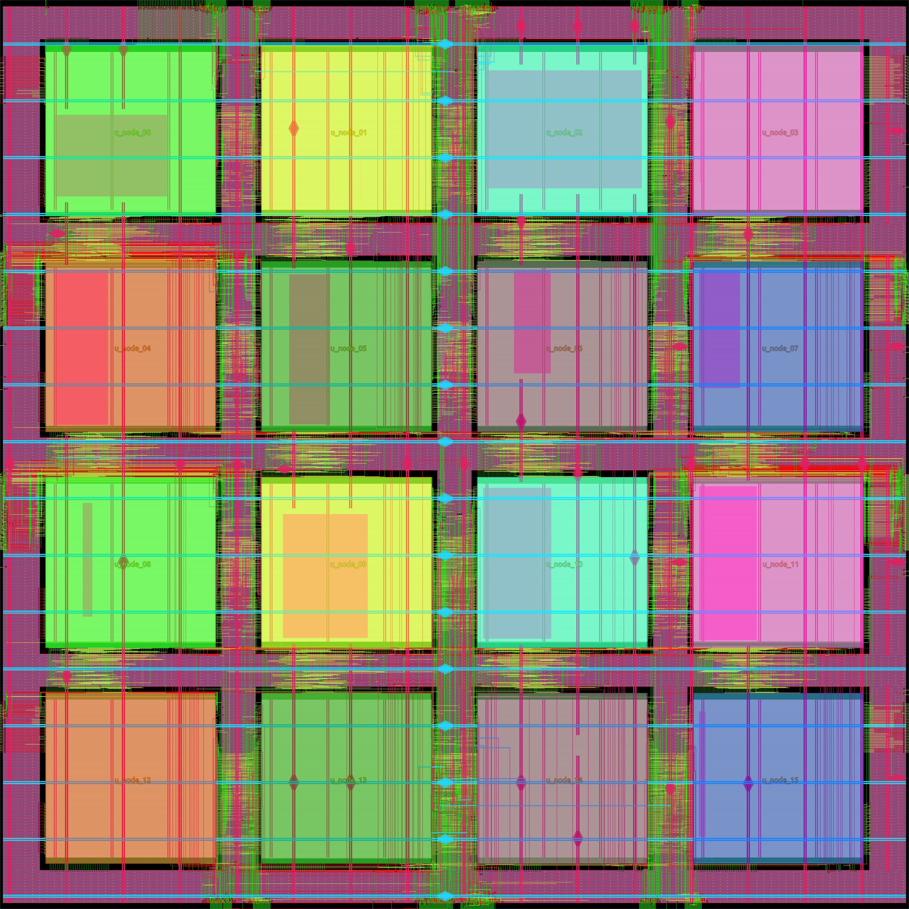

# Physical implementation results

| Metric | Value |
| --- | ---: |
| Core area | 2.50655 mm2 |
| Die area | 2.56 mm2 |
| Total estimated power | 26.1138 mW |
| Worst setup / hold slack | 34.95 / 17.78 ps |
| Magic / KLayout DRC violations | 0 / 0 |
| LVS errors / routing antenna violations | 0 / 0 |
| Mean independently characterized switch power | 1.6953 mW |
| Independent switch power range | 1.3166--2.0957 mW |

These are post-layout estimates, not silicon measurements. 

