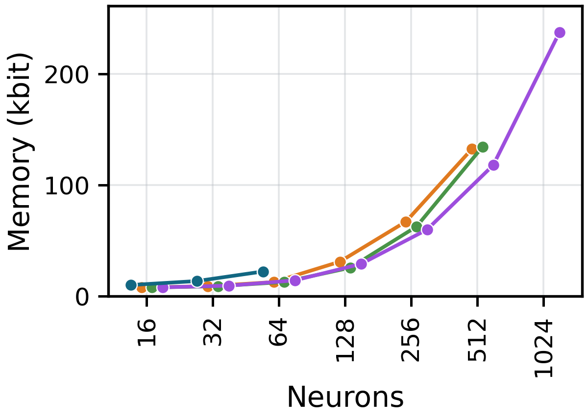
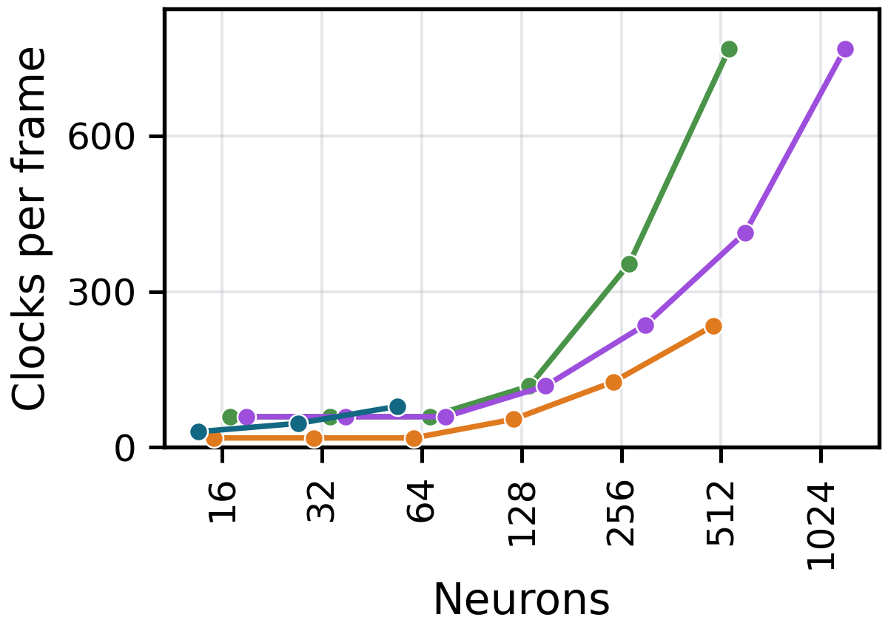
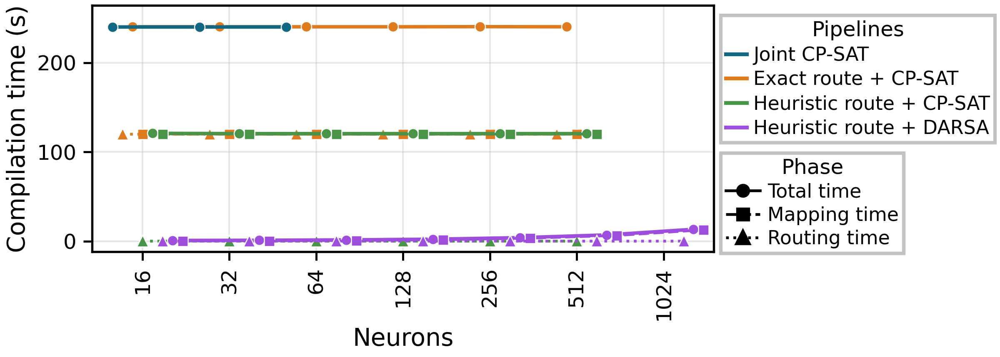

# Four-pipeline comparison

Compare application joint CP-SAT, exact route + CP-SAT, heuristic route + CP-SAT, and heuristic route + DARSA.

```sh
python software/compilation/run_study.py --out results/compilation --delay-profiles 5:20
python software/compilation/plot.py --csv results/compilation/metrics.csv --out results/compilation/figures --profiles 5:20
```

Requires OR-Tools. Only end-to-end feasible cases are plotted. Solver checkpoints
are temporary; rerunning starts a new study. Timing depends on the execution host.







