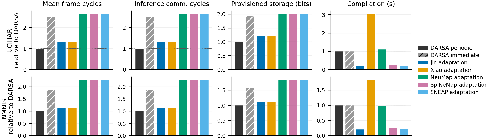

# Deployment comparison

Compare DARSA periodic and same-placement immediate reservations with adaptations
of Jin, Xiao, NeuMap, SpiNeMap, and SNEAP on a common TDM substrate.
The adaptations are not the original authors' official packages.

Run from the repository root:

```sh
python software/deployment_comparison/run_study.py --out results/deployment_comparison
python software/deployment_comparison/plot.py --csv results/deployment_comparison/metrics.csv --out results/deployment_comparison/figures
```



