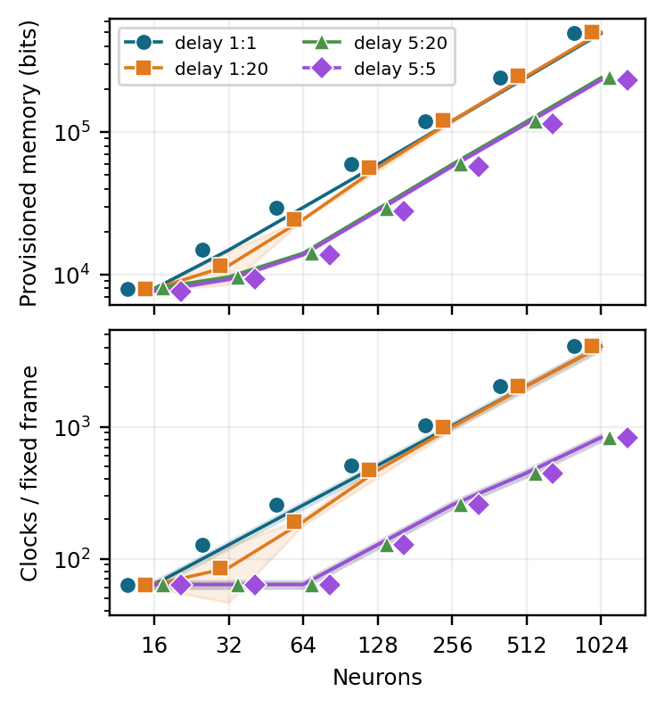
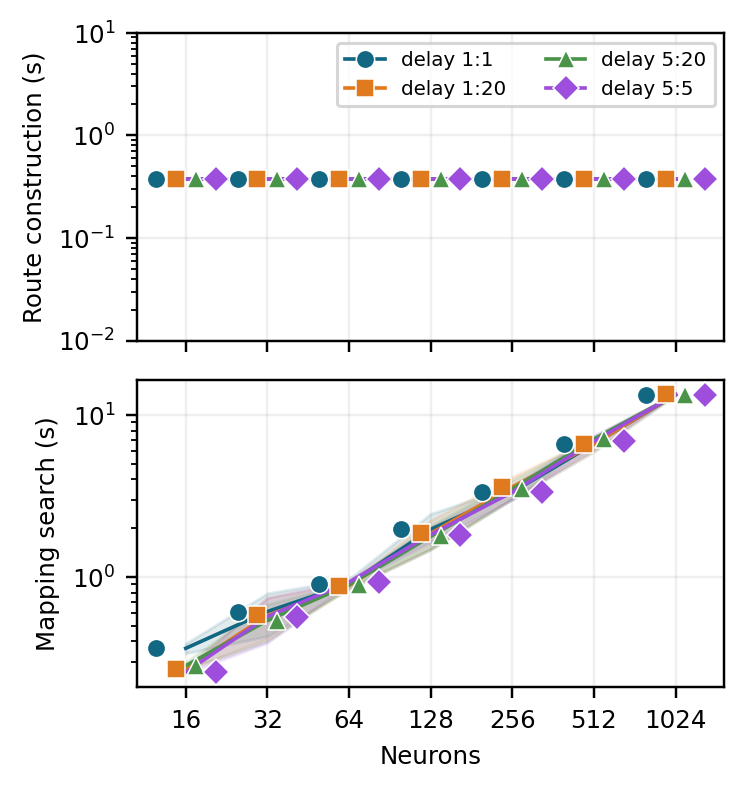

# Logical-workload scaling

Fixed 4x4 mesh; the default sweep varies 16–1024 neurons across four delay profiles.

```sh
python software/logical_scaling/run_study.py --out results/logical_scaling
python software/logical_scaling/plot.py --csv results/logical_scaling/metrics.csv --out results/logical_scaling/figures
```





