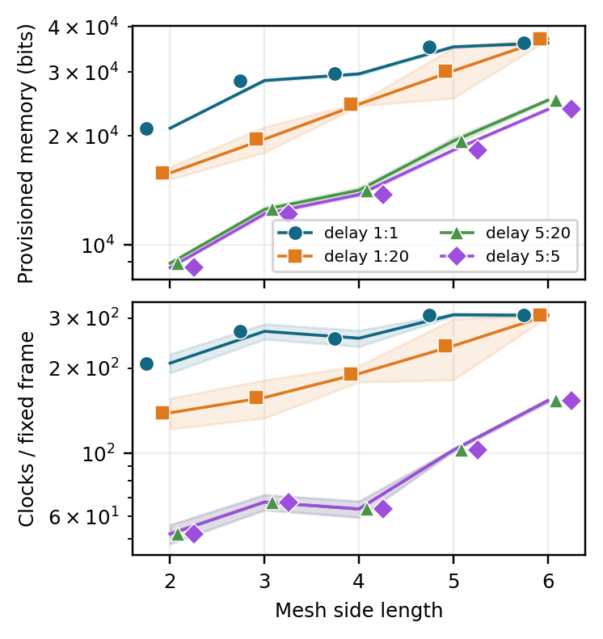
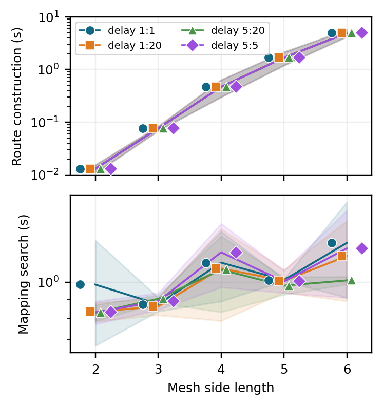

# Physical-grid scaling

A fixed 64-neuron workload is mapped onto meshes with side lengths 2–6.

```sh
python software/physical_scaling/run_study.py --out results/physical_scaling
python software/physical_scaling/plot.py --csv results/physical_scaling/metrics.csv --out results/physical_scaling/figures
```





