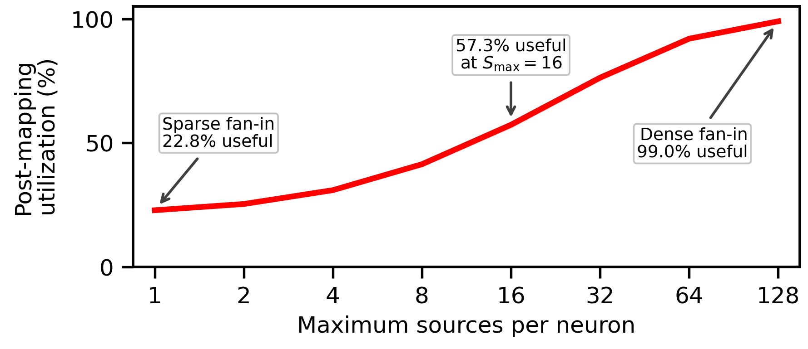

# Structural utilization

Vary maximum source fan-in on a fixed 4x4 mesh with 1024 neurons. The supplied plot uses the 1:20 delay profile and simultaneous firing.

```sh
python software/utilization/run_study.py --out results/utilization
python software/utilization/plot.py --csv results/utilization/metrics.csv --out results/utilization/figures
```



